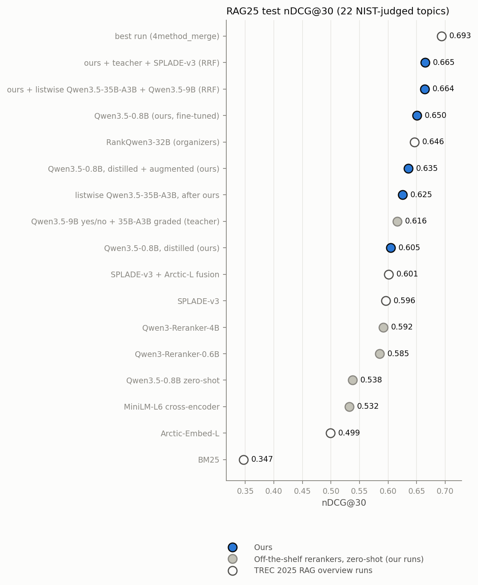
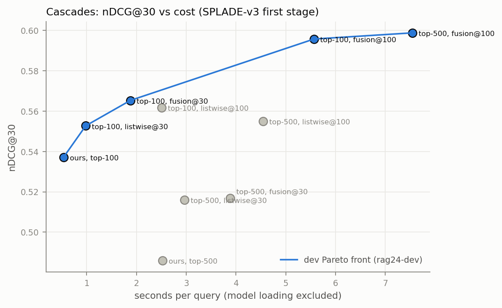
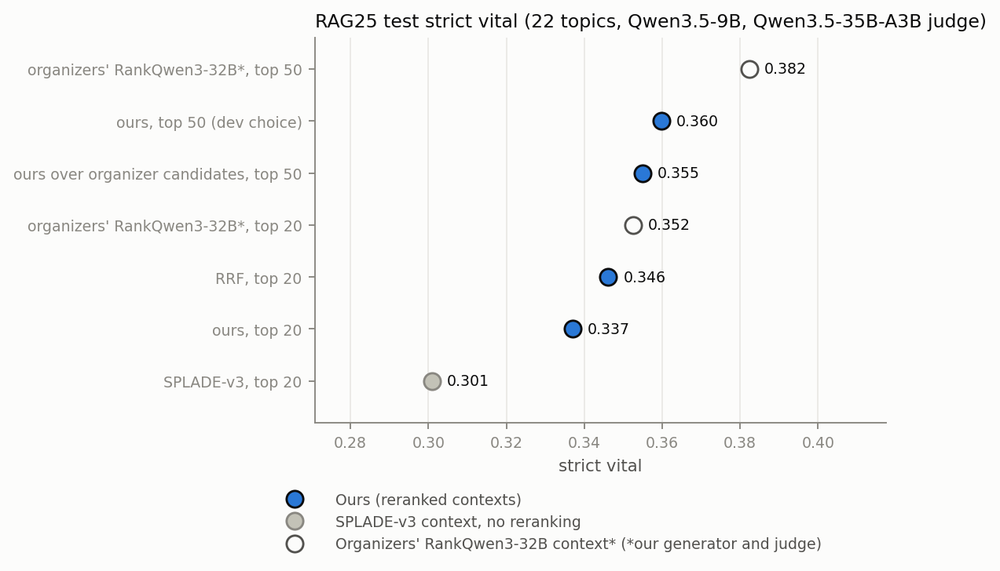

# Retrieval Ranking Lab

### A hands-on lab for building, running, and comparing the retrieval and ranking stack behind frontier search, recommendation, and ads systems: first-stage retrieval, reranking, LLM rankers, RAG, etc.

- [LLM Reranking](studies/llm_reranking/README.md): fine-tuning small LLM rerankers for complex search queries, and combining them
  with larger LLMs through distillation, fusion, and cost-bounded cascades.
- [RAG](studies/rag/README.md): generating cited answers for complex search queries from reranked contexts, and improving
  their coverage through context size, document diversity, and sub-question retrieval.

```
src/retrieval_ranking_lab/
  data/trec_rag.py      topics, NIST qrels, sub-narratives, nuggets, segment lookup
  retrieval/            bm25.py, splade.py (Pyserini prebuilt indexes), hybrid.py (RRF)
  rerank/               cross_encoder.py, llm_reranker.py (yes/no scoring, LoRA adapters)
  pipeline.py           retrieve then rerank
  eval/metrics.py       trec_eval-compatible nDCG, Recall, MRR, P, MAP
  eval/overview_2025.py reference scores from the overview
  generators.py         vLLM and Claude backends
  cli.py                download-data, run, fuse, evaluate
studies/llm_reranking/  fine-tuning, teacher scores and distillation, fusion, listwise reranking, cascades, figures, report
studies/rag/            generation, nugget and support evaluation, judge check, sub-question retrieval
```

## Quick Start

Needs Java 21 (Pyserini) and about 110 GB for the BM25 and SPLADE-v3 indexes.

```bash
pip install -r requirements.txt
export PYTHONPATH=src         # run all commands from the repo root
export HF_HUB_DISABLE_XET=1   # hf_xet downloads stall on this machine

python -m retrieval_ranking_lab download-data
python -m retrieval_ranking_lab run --retriever splade --k-retrieve 1000
python -m retrieval_ranking_lab run --first-stage-run runs/rag25/splade.trec --reranker llm --rerank-model Qwen/Qwen3-Reranker-4B
```

`run` scores the 22 NIST-judged RAG25 topics by default. Add `--all-topics` for all 105.

## Data

The current benchmark is the TREC 2025 RAG track on the MS MARCO V2.1 segmented corpus (113.5M segments).
Results are reported next to the track overview (arXiv:2603.09891).

| Item | Source |
|---|---|
| Corpus | MS MARCO V2.1 segmented, read through the Pyserini BM25 index |
| RAG25 topics | 105 narratives, `trec_rag_2025_queries.jsonl` |
| RAG25 qrels | NIST, 22 topics, grades 0–4 |
| RAG25 nuggets | post-edited, 22 topics, vital / okay, mapped to sub-narratives |
| RAG25 candidates | organizer RankQwen3-32B top-100 (AG task input) |
| RAG24 qrels | UMBRELA (301 topics) for training and NIST (89 topics) for dev |
| RAG24 nuggets | track nuggets with NIST assignments, 56 topics (CoverageBench release), the RAG dev set |

Our metrics reproduce the overview's scores exactly (e.g. `rag25_test_rankqwen3`: 0.6462 / 0.5844 / 0.2274).
Our runs were not in the judgment pool, so unjudged segments count as non-relevant and our scores are conservative.

## Models

Qwen3.5 for all LLM roles:

| Role | Model |
|---|---|
| Fine-tuned reranker (ours) | Qwen3.5-0.8B |
| Teachers and fusion members, pointwise | Qwen3.5-9B (yes/no), Qwen3.5-35B-A3B-GPTQ-Int4 (graded 0–3) |
| Listwise reranker | Qwen3.5-35B-A3B-GPTQ-Int4 |
| RAG generator / judge | Qwen3.5-9B / Qwen3.5-35B-A3B-GPTQ-Int4 |

Qwen3.5 has no reranker model, so Qwen3-Reranker is the purpose-built reference.

## Results

### LLM Reranking

Takeaways (details in [Findings](studies/llm_reranking/README.md#findings)):

- Fine-tuning works: our fine-tuned Qwen3.5-0.8B reaches 0.650 nDCG@30 on RAG25, on par with the organizers' 32B reranker.
- Larger zero-shot Qwen3.5 models gain on dev but not on RAG25, alone or distilled into ours.
- Fusing them with ours by RRF is best: up to 0.665, 4th of 47 runs, though not significant.
- An LLM stage on only the top 30 gets half the fusion gain at a third of the cost (dev).

| RAG25 (22 topics) | nDCG@30 | nDCG@100 |
|---|---|---|
| SPLADE-v3 | 0.596 | 0.539 |
| SPLADE-v3 → Qwen3-Reranker-4B | 0.592 | 0.542 |
| SPLADE-v3 → Qwen3.5-0.8B (ours, fine-tuned) | 0.650 | 0.557 |
| SPLADE-v3 → Qwen3.5-0.8B, distilled (ours) | 0.605 | 0.546 |
| SPLADE-v3 → Qwen3.5-0.8B, distilled + augmented (ours) | 0.635 | 0.553 |
| **SPLADE-v3 → ours + listwise Qwen3.5-35B-A3B + Qwen3.5-9B (RRF)** | **0.664** | **0.559** |
| *overview* RankQwen3-32B (organizers) | 0.646 | 0.584 |



- The fine-tuned model is significantly above SPLADE-v3 and Qwen3-Reranker-4B (p ≤ 0.01) and level with RankQwen3-32B (p = 0.80). See [test results](studies/llm_reranking/README.md#test-results).
- Distilled from a Qwen3.5-9B + 35B-A3B teacher, the model scores below the fine-tuned one on RAG25 (p = 0.001), and augmenting with unjudged segments recovers part of the gap. See [data augmentation and distillation](studies/llm_reranking/README.md#data-augmentation-and-distillation).
- RRF adds 0.014 over the fine-tuned model (p = 0.16) and would rank 4th of 47 R-task runs, at the cost of a listwise 35B-A3B pass and a pointwise 9B pass. See [listwise LLM reranking](studies/llm_reranking/README.md#listwise-llm-reranking) and [fusion](studies/llm_reranking/README.md#fusion).
- Every system is selected on RAG24 dev. See [fine-tuning](studies/llm_reranking/README.md#fine-tuning) and the [protocol](studies/llm_reranking/README.md#protocol).
- BM25 and SPLADE-v3 reproduce the organizer baselines. See [baselines](studies/llm_reranking/README.md#baselines).



- On dev, cascades range from 0.537 for ours alone (0.53 s/query) to 0.596 with fusion on the top 100 (5.6 s/query). See [cascades](studies/llm_reranking/README.md#cascades).

### RAG

Takeaways (details in [Findings](studies/rag/README.md#findings)):

- Better retrieval gives better answers: reranked contexts cover more vital nuggets than SPLADE-v3 alone.
- A larger context helps: the top 50 of our reranker gains 0.058 strict vital on dev and 0.023 on test over the top 20,
  which brings it level with the organizers' RankQwen3-32B context on RAG25.
- Wider retrieval does not close the rest of the gap: every context misses the same 20% of sub-narratives.
- Citation support stays at 0.82–0.89 for every context and every generator from 2B up.
- Our Qwen3.5 judge ranks systems almost as NIST assessors do (Kendall τ = 0.873).

| RAG25 (22 topics), Qwen3.5-9B | strict_vital | subnarrative_coverage | support_precision |
|---|---|---|---|
| ours, top 20 | 0.337 | 0.582 | 0.866 |
| ours, top 50 (dev choice) | 0.360 | 0.631 | 0.840 |
| ours over organizer candidates, top 50 | 0.355 | 0.634 | 0.821 |
| **organizers' RankQwen3-32B*, top 50** | **0.382** | **0.635** | **0.845** |

\* The organizers' RankQwen3-32B context, answered and judged by our Qwen3.5-9B generator and Qwen3.5-35B-A3B judge instead of theirs.

- The dev choice gains 0.023 strict vital over the top 20 on test and is level with the organizers' context* (p = 0.27).
- Since every context misses the same sub-narratives, further gains have to come from how the answer covers the topic.
  See [test results](studies/rag/README.md#test-results).



## Reference

### Papers, Reports and Blogs

- TREC 2025 RAG Overview, track results (202603): [arXiv](https://arxiv.org/abs/2603.09891)
- Qwen3.5, native multimodal agents (202602): [Blog](https://qwen.ai/blog?id=qwen3.5)
- TREC 2025 RAG Corpus, segmented corpus and qrels (202505): [Website](https://trec-rag.github.io/annoucements/2025-rag25-corpus/)
- Arctic-Embed, dense text embeddings (202405): [arXiv](https://arxiv.org/abs/2405.05374)
- SPLADE-v3, learned sparse retrieval (202403): [arXiv](https://arxiv.org/abs/2403.06789)
- Pyserini, reproducible sparse and dense IR (202102): [arXiv](https://arxiv.org/abs/2102.10073)
- MS MARCO, web search dataset (201611): [arXiv](https://arxiv.org/abs/1611.09268)
- RRF, reciprocal rank fusion (200907): [ACM](https://dl.acm.org/doi/10.1145/1571941.1572114)

### Code

- castorini/pyserini: [GitHub](https://github.com/castorini/pyserini)
- TREC-RAG/trec-rag-data: [GitHub](https://github.com/TREC-RAG/trec-rag-data)
