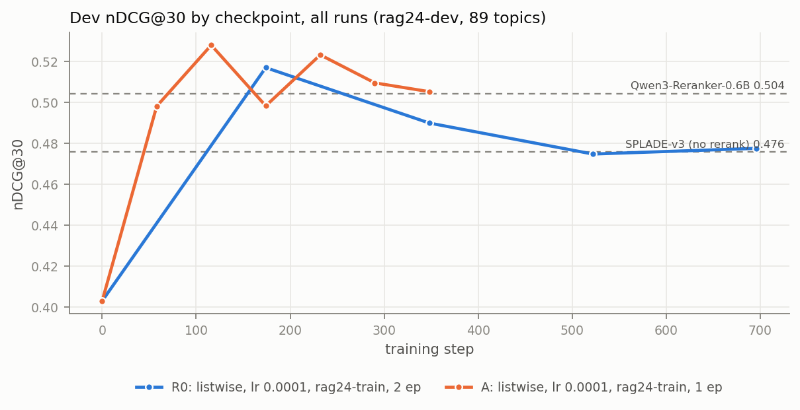
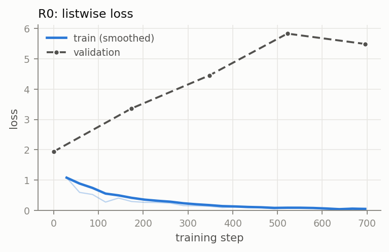
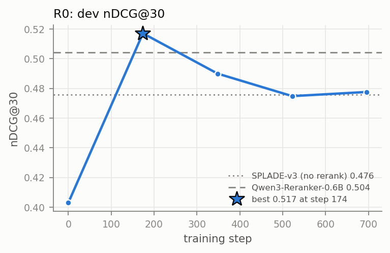
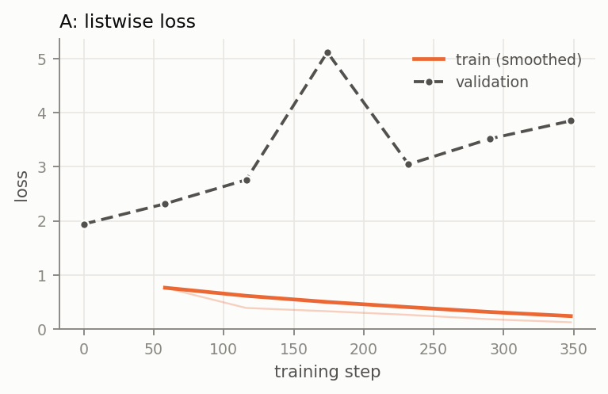
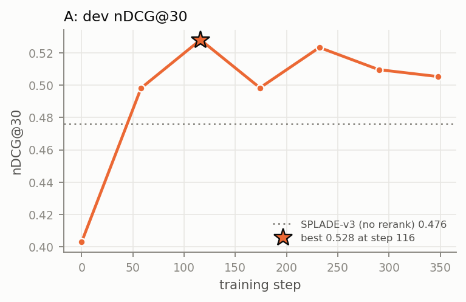

# LLM Reranking Study

LoRA-tuned Qwen3.5 models as pointwise yes/no rerankers on RAG25. Training uses RAG24 qrels on the same corpus.

The score is `logit("yes") - logit("no")` with the Qwen3-Reranker prompt. Inference and training share the same encoder.
References: MiniLM cross-encoder, Qwen3-Reranker (no Qwen3.5 reranker exists), and overview Table 5.

## Protocol

| Set | Topics | Labels | Use |
|---|---|---|---|
| `rag24-train` | 212 | UMBRELA | training |
| `rag24-dev` | 89 | NIST | tuning (learning rate, checkpoint, depth, prompt) |
| `rag25` | 22 | NIST | final test, once per frozen configuration |
| `rag24-all` | 301 | UMBRELA | optional retrain with frozen settings |

- Track participants submitted before RAG25 labels existed. We can see them, so we never tune on RAG25.
- Every RAG25 evaluation is appended to `outputs/llm_reranking/rag25_evaluations.jsonl`. Report all of them.
- Decontamination (default): drop RAG24 topics with TF-IDF cosine > 0.25 to any RAG25 topic, and every RAG25-judged segment.
  This is stricter than the track required. `build_data --no-decontaminate` gives the ablation.
- Qwen3.5 was released after RAG25 labels were public. Pretraining exposure cannot be ruled out. Qwen3-Reranker and the non-LLM baselines predate it.

## Run

```bash
python -m retrieval_ranking_lab run --topics rag24-dev --retriever splade --k-retrieve 1000
python -m retrieval_ranking_lab run --topics rag25 --retriever splade --k-retrieve 1000

python -m studies.llm_reranking.build_data --split rag24-train

python -m studies.llm_reranking.train --data data/reranker_train/rag24-train.jsonl \
    --base-model Qwen/Qwen3.5-0.8B --out checkpoints/qwen3.5-0.8b-rag24

# tuning
python -m studies.llm_reranking.evaluate --topics rag24-dev \
    --rerankers llm:Qwen/Qwen3.5-0.8B,lora:checkpoints/qwen3.5-0.8b-rag24,llm:Qwen/Qwen3-Reranker-4B

# final test, frozen configuration
python -m studies.llm_reranking.evaluate --topics rag25 --rerankers lora:checkpoints/qwen3.5-0.8b-rag24
```

## Notes

- Positives: grade ≥ 2. Negatives: judged grade 0 from the same topic, which are hard negatives from the pool.
- RAG24 topics are short questions. RAG25 topics are multi-sentence narratives.
- 22 test topics give high variance. Report per-topic results before drawing conclusions.

## Dev Results

`rag24-dev` (89 NIST-judged RAG24 topics), reranking the SPLADE-v3 top-100. R@100 is 0.331 for every row.

| Reranker | nDCG@30 | nDCG@100 | s/query |
|---|---|---|---|
| SPLADE-v3, no rerank | 0.476 | 0.450 | – |
| MiniLM-L6 cross-encoder | 0.451 | 0.442 | 0.06 |
| Qwen3.5-0.8B zero-shot | 0.403 | 0.423 | 0.47 |
| **Qwen3.5-0.8B + LoRA, R0 step 174** | **0.517** | **0.464** | 0.49 |
| Qwen3.5-0.8B + LoRA, R0 step 696 | 0.478 | 0.452 | 0.49 |
| Qwen3-Reranker-0.6B | 0.504 | 0.462 | 0.46 |
| Qwen3-Reranker-4B | 0.553 | 0.478 | 2.29 |

R0: learning rate 1e-4, listwise loss, up to 32 positives per topic, 2 epochs. A: same, 1 epoch, a checkpoint every 58 steps.




| Run | Train vs validation loss | Dev nDCG@30 by checkpoint |
|---|---|---|
| R0 |  |  |
| A |  |  |

- Fine-tuning lifts Qwen3.5-0.8B from 0.403 to 0.517 (R0) and 0.528 (A, step 116), above Qwen3-Reranker-0.6B.
- Validation loss rises from the first checkpoint while dev accuracy and nDCG@30 improve: the model becomes overconfident on its mistakes.
  Select checkpoints by dev nDCG@30, not validation loss.
- R0 overfits after half an epoch. Each topic repeats up to 32 times per epoch with the same negatives.
- Sweep B–D (8 positives per topic, lower learning rate, pointwise loss) is in progress.

Regenerate the figures with `plot_results.py`, one `--run name:checkpoint_dir:dev_summary_json` per run.

## Ablations

| Axis | Options |
|---|---|
| decontamination | default / `--no-decontaminate` |
| training qrels | `rag24-train` / `rag24-all` |
| loss | `--loss-type listwise` / `pointwise` |
| base model | Qwen3.5-0.8B / 2B / 4B, post-trained vs `-Base` |
| LoRA rank | 8 / 32 / 128 |
| first stage and depth | BM25 / SPLADE-v3, top 50 / 100 / 200 |

## Reference

### Papers, Reports and Blogs

- Qwen3 Embedding, source of Qwen3-Reranker (202506): [arXiv](https://arxiv.org/abs/2506.05176)
- RankLLM, LLM reranking toolkit (202505): [arXiv](https://arxiv.org/abs/2505.19284)
- UMBRELA, LLM relevance assessor (202406): [arXiv](https://arxiv.org/abs/2406.06519)
- RankZephyr, open listwise reranker (202312): [arXiv](https://arxiv.org/abs/2312.02724)
- RankLLaMA, fine-tuned LLM pointwise reranker (202310): [arXiv](https://arxiv.org/abs/2310.08319)
- RankGPT, zero-shot listwise reranking (202304): [arXiv](https://arxiv.org/abs/2304.09542)
- LoRA, low-rank adaptation (202106): [arXiv](https://arxiv.org/abs/2106.09685)
- monoT5, seq2seq reranker (202003): [arXiv](https://arxiv.org/abs/2003.06713)
- monoBERT, BERT cross-encoder reranker (201901): [arXiv](https://arxiv.org/abs/1901.04085)

### Code

- QwenLM/Qwen3-Embedding: [GitHub](https://github.com/QwenLM/Qwen3-Embedding)
- castorini/rank_llm: [GitHub](https://github.com/castorini/rank_llm)
- huggingface/peft: [GitHub](https://github.com/huggingface/peft)
