# LLM Reranking

### Fine-tuning small LLM rerankers for complex search queries, and combining them with larger LLMs through distillation, fusion, and cost-bounded cascades.

Takeaways (details in [Findings](#findings)):

- Fine-tuning works: Qwen3.5-0.8B + LoRA reaches 0.650 nDCG@30 on RAG25, on par with the organizers' 32B reranker.
- Larger zero-shot Qwen3.5 models gain on dev but not on RAG25, alone or distilled into ours.
- Fusing them with ours by RRF is best: 0.665, 4th of 47 runs, though not significant.
- An LLM stage on only the top 30 gets half the fusion gain at a third of the cost (dev).
- Downstream, contexts from our reranker give better RAG answers than SPLADE-v3 ([RAG study](../rag/README.md)).


## Setup

- Task: TREC 2025 RAG R task, MS MARCO V2.1 segmented corpus. Metrics: nDCG@30, nDCG@100, Recall@100 (overview Table 5).
- First stage: SPLADE-v3 top-1000 from the Pyserini impact index. Rerankers score its top-100.
- Prompt: the Qwen3-Reranker yes/no template with the topic narrative as the query.
- Score: `logit("yes") - logit("no")` at the last token, computed in float32 from the final hidden state.
- Model: Qwen3.5-0.8B, LoRA rank 32 / alpha 64 on all linear layers (21.6M trainable parameters), bf16.
- Training groups: 1 positive (grade ≥ 2) + 7 judged grade-0 negatives from the same topic, 16 groups per update, max length 512.
- Losses: listwise softmax cross-entropy over the group (RankLLaMA), or pointwise yes/no cross-entropy.
- Defaults: AdamW, cosine schedule with 5% warmup, gradient clipping at 1.0.
- Larger models, zero-shot through vLLM: Qwen3.5-9B (yes/no margin) and Qwen3.5-35B-A3B-GPTQ-Int4 (graded 0–3,
  and listwise with windows of 20, stride 10). Fusion is RRF with constant 60 and equal weights.

## Protocol

| Set | Topics | Labels | Use |
|---|---|---|---|
| `rag24-train` | 212 | UMBRELA | training |
| `rag24-dev` | 89 | NIST | tuning and checkpoint selection |
| `rag25` | 22 | NIST | test |

- We never tune on RAG25.
- Checkpoints and systems are selected by dev nDCG@30. Validation loss is reported but not used for selection.
- Each section sends only its dev-selected systems to RAG25, once. Cascades are evaluated on dev only.
- Decontamination drops RAG24 topics with TF-IDF cosine > 0.25 to any RAG25 topic (12 of 212) and every RAG25-judged segment.
- Every RAG25 evaluation is logged in `outputs/llm_reranking/rag25_evaluations.jsonl`.
- Qwen3.5 was released after RAG25 labels were public. Pretraining exposure cannot be ruled out.

## Baselines

RAG25, no LLM:

| System | nDCG@30 | nDCG@100 | R@100 |
|---|---|---|---|
| BM25 | 0.3468 | 0.2900 | 0.1107 |
| SPLADE-v3 | **0.5957** | **0.5389** | **0.2105** |
| BM25 + SPLADE-v3 (RRF) | 0.5292 | 0.5002 | 0.2003 |
| SPLADE-v3 → MiniLM-L6 @100 | 0.5319 | 0.5220 | 0.2105 |
| RRF → MiniLM-L6 @100 | 0.5486 | 0.5009 | 0.2003 |
| *overview* `anserini_bm25_top100` | 0.3468 | 0.2900 | 0.1107 |
| *overview* `rag25_test_splade-v3` | 0.5957 | 0.5387 | 0.2103 |

- BM25 and SPLADE-v3 reproduce the organizer baselines.
- Equal-weight RRF with BM25 hurts SPLADE-v3, and so does the MiniLM cross-encoder, which was trained on short queries.

## Fine-tuning

Every run is scored on `rag24-dev` (89 topics, SPLADE-v3 top-100) at each checkpoint. R@100 is 0.331 for every row.
Run names list the loss, LR, positives per topic, and epochs; full-data runs add the schedule, clipping, and any extra option.
Checkpoints live in `checkpoints/reranker/<run>`.

### 1. Zero-shot

| Reference | nDCG@30 | nDCG@100 | s/query |
|---|---|---|---|
| SPLADE-v3, no rerank | 0.476 | 0.450 | – |
| MiniLM-L6 cross-encoder | 0.451 | 0.442 | 0.04 |
| Qwen3.5-0.8B zero-shot | 0.401 | 0.423 | 0.47 |
| Qwen3-Reranker-0.6B | 0.505 | 0.462 | 0.46 |
| Qwen3-Reranker-4B | 0.556 | 0.478 | 2.35 |

- Zero-shot Qwen3.5-0.8B falls below the first stage, so it needs fine-tuning.
- Purpose-built Qwen3-Reranker sets the targets: 0.505 at 0.6B, 0.556 at 4B.

### 2. Small Data: Loss and Learning Rate

8 positives per topic (1,529 groups), 3 epochs, 288 updates.

| Run | Loss | LR | Best step | nDCG@30 | nDCG@100 |
|---|---|---|---|---|---|
| `listwise_lr1e-4_pos8_epoch3` | listwise | 1e-4 | 144 | 0.527 | 0.472 |
| `pointwise_lr1e-4_pos8_epoch3` | pointwise | 1e-4 | 144 | 0.531 | 0.472 |
| `listwise_lr5e-5_pos8_epoch3` | listwise | 5e-5 | 144 | 0.534 | 0.474 |

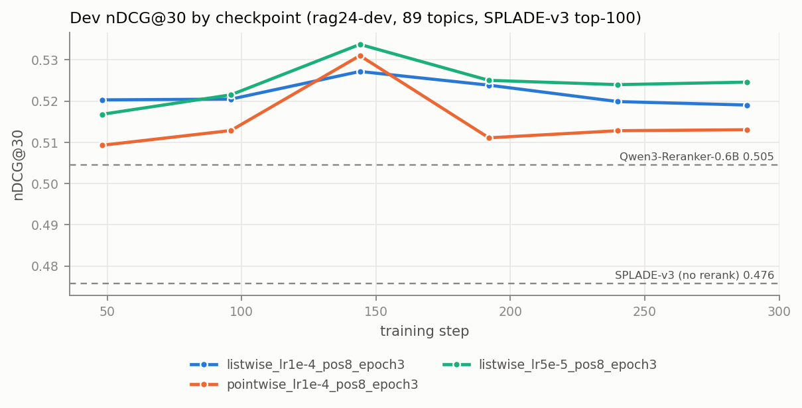

| Run | Train vs validation loss | Dev nDCG@30 by checkpoint |
|---|---|---|
| `listwise_lr1e-4_pos8_epoch3` | 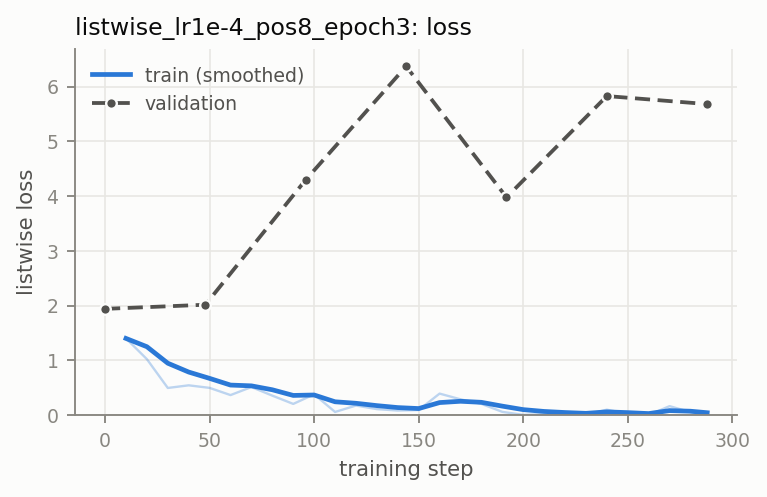 | 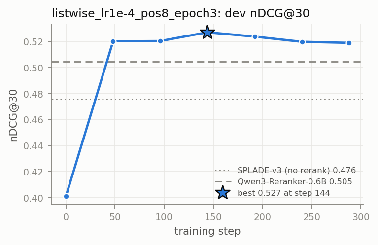 |
| `pointwise_lr1e-4_pos8_epoch3` | 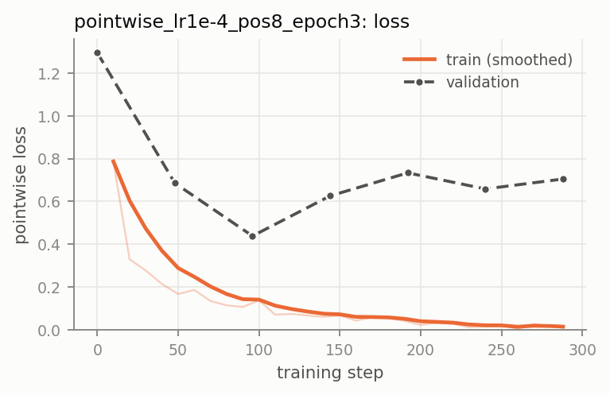 | 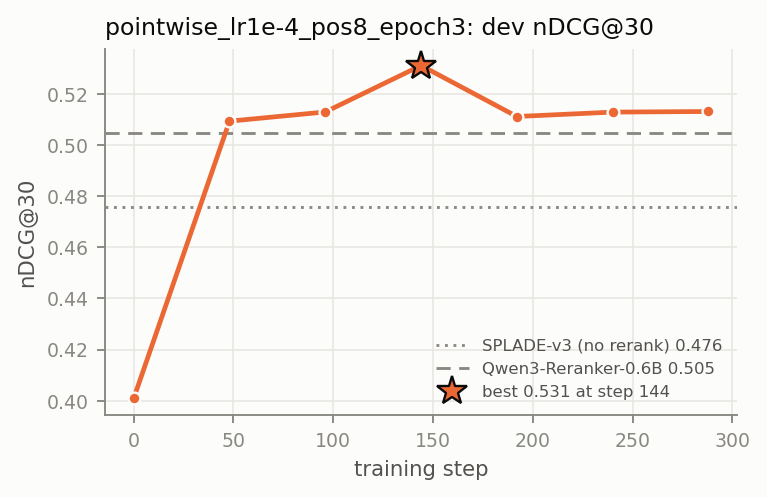 |
| `listwise_lr5e-5_pos8_epoch3` | 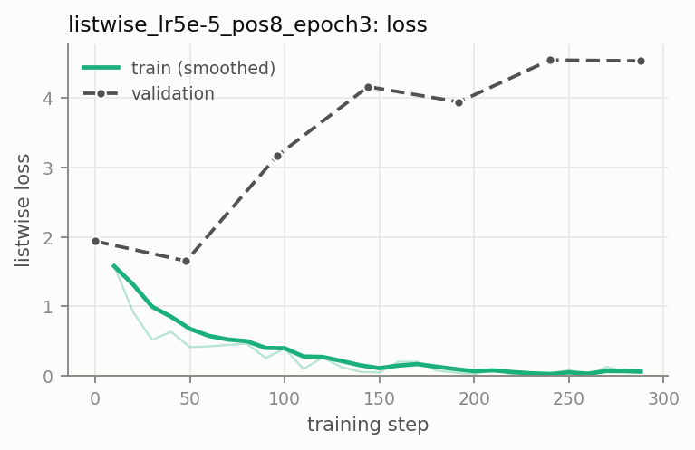 | 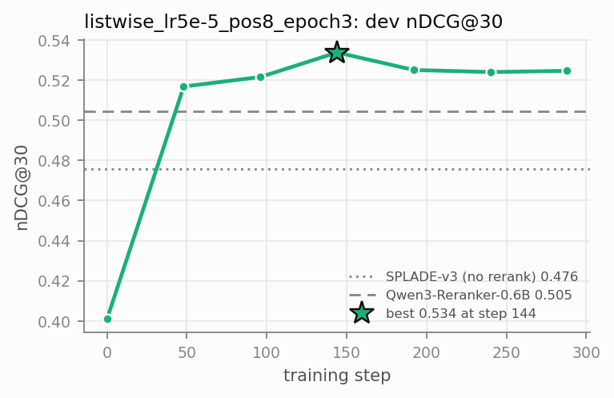 |

- Fine-tuning already beats Qwen3-Reranker-0.6B. All three runs land within 0.007.
- All three peak at step 144, halfway through. Later epochs repeat the same groups and hurt.
- Listwise validation loss rises while dev accuracy and nDCG@30 improve: the model becomes overconfident on its mistakes.
  Pointwise validation loss stays flat.
- Loss and LR matter little here, so the full-data runs keep listwise loss at LR 1e-4 and add data instead of epochs.

### 3. Full Data: Training Configuration

32 positives per topic (5,564 groups), listwise loss, LR 1e-4. Each run is one complete configuration:

- Schedule: cosine or WSD (20% decay), one epoch.
- Optimizer: AdamW β2 0.999, or 0.95 with weight decay 0.01; LoRA+ (B matrices at 4× LR).
- Gradient clipping: max norm 1.0, 10, or none.
- Score control: score z-loss, margin soft-cap, temperature, label smoothing.
- Weight averaging: EMA of the LoRA weights (decay 0.99).

Sorted by best dev nDCG@30. Recall@30 is taken at that checkpoint; SPLADE-v3 alone gives 0.144.
`listwise_lr1e-4_pos32_epoch1_cosine_clip1_avg3_ckpts` averages the LoRA weights of the best checkpoint of `listwise_lr1e-4_pos32_epoch1_cosine_clip1` (step 290) and its two neighbors.
Best dev loss: the lowest loss on the frozen dev groups over the checkpoints (step 0, untrained, is 1.94).

| Run | Best dev nDCG@30 (step) | Recall@30 | Best dev loss (step) |
|---|---|---|---|
| `listwise_lr1e-4_pos32_epoch1_cosine_clip1_loraplus4` | 0.522 (290) | 0.154 | 2.30 (58) |
| `listwise_lr1e-4_pos32_epoch1_cosine_clip10` | 0.523 (290) | 0.156 | 2.08 (58) |
| `listwise_lr1e-4_pos32_epoch1_cosine_clip1_smoothing0.1` | 0.526 (174) | 0.161 | 1.49* (174) |
| `listwise_lr1e-4_pos32_epoch1_cosine_clip1_ema0.99` | 0.527 (174) | 0.160 | 2.12 (116) |
| `listwise_lr1e-4_pos32_epoch1_cosine_clip1_softcap20` | 0.528 (348) | 0.158 | 2.15 (116) |
| `listwise_lr1e-4_pos32_epoch1_cosine_noclip_zloss1e-3_beta2_0.95_wd0.01` | 0.529 (290) | 0.160 | 1.75 (174) |
| `listwise_lr1e-4_pos32_epoch1_cosine_clip1_beta2_0.95_wd0.01` | 0.530 (290) | 0.159 | 2.38 (116) |
| `listwise_lr1e-4_pos32_epoch1_cosine_clip1_zloss1e-3` | 0.531 (174) | 0.162 | 1.89 (174) |
| `listwise_lr1e-4_pos32_epoch1_cosine_clip1_temperature2` | 0.532 (290) | 0.159 | 4.11* (58) |
| `listwise_lr1e-4_pos32_epoch1_wsd_clip1` | 0.532 (116) | 0.161 | 2.19 (174) |
| `listwise_lr1e-4_pos32_epoch1_cosine_noclip_zloss1e-3` | 0.532 (232) | 0.164 | 1.77 (174) |
| `listwise_lr1e-4_pos32_epoch1_cosine_noclip` | 0.533 (290) | 0.160 | **1.58** (58) |
| `listwise_lr1e-4_pos32_epoch1_cosine_clip1_avg3_ckpts` | 0.533 (avg. of 232, 290, 348) | 0.161 | 2.90 |
| **`listwise_lr1e-4_pos32_epoch1_cosine_clip1`** | **0.537** (290) | **0.164** | 1.89 (58) |

\* Not comparable: dev loss uses hard targets and raw margins, while these runs trained on smoothed targets or scaled margins.

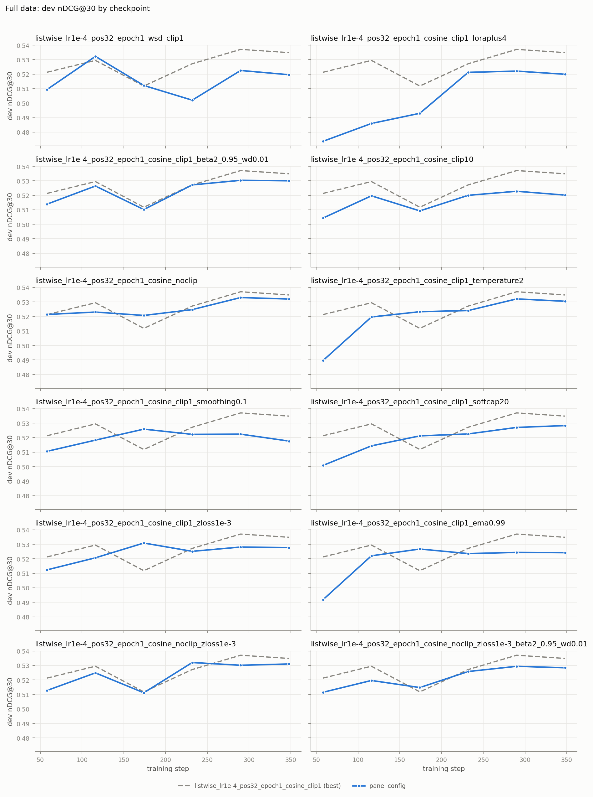

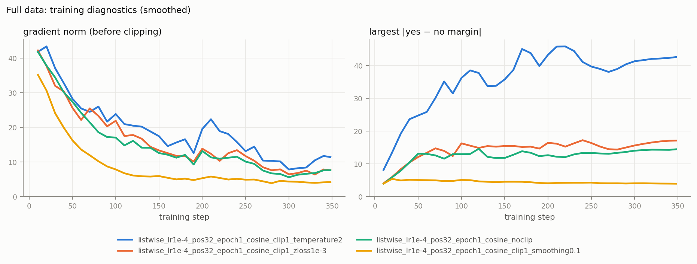

- More data beats more epochs: one pass over 32 positives per topic beats three passes over 8.
- Dev loss is lowest early (steps 58–174) and then rises, while dev nDCG@30 mostly keeps improving.
- Gradient norm averages 13–19 against a clip threshold of 1.0. Removing clipping beats raising it to 10.
- Score z-loss, EMA, and no clipping give the steadiest curves.
  Z-loss bounds the margins, EMA flattens the late curve, and no clipping gives the lowest comparable dev loss.
  Z-loss and no clipping keep comparable dev loss below the untrained 1.94; the plain configuration dips below it only at step 58.
- Label smoothing caps margins near 7 but scores lower, and temperature 2 lets raw margins grow past 50.
- WSD swings the most across checkpoints, and LoRA+ starts slowest.
- The plain configuration, `listwise_lr1e-4_pos32_epoch1_cosine_clip1`, scores highest at 0.537.
- Combining no clipping with z-loss gives 0.532 and Recall@30 0.164, level with the plain configuration, with dev loss 1.77 and margins under 16.
  Adding AdamW β2 0.95 and weight decay gives 0.529. Neither combination beats its parts or the plain configuration.

### 4. Dev Results

The best dev nDCG@30 over every checkpoint of every run: `listwise_lr1e-4_pos32_epoch1_cosine_clip1`, step 290 (0.537).
Outside this section it is called **Qwen3.5-0.8B + LoRA (ours)**.
It lifts Qwen3.5-0.8B from 0.401 to 0.537, above Qwen3-Reranker-0.6B and 0.019 below Qwen3-Reranker-4B,
at the speed of Qwen3-Reranker-0.6B (0.49 s/query).

| Train vs validation loss | Dev nDCG@30 by checkpoint |
|---|---|
| 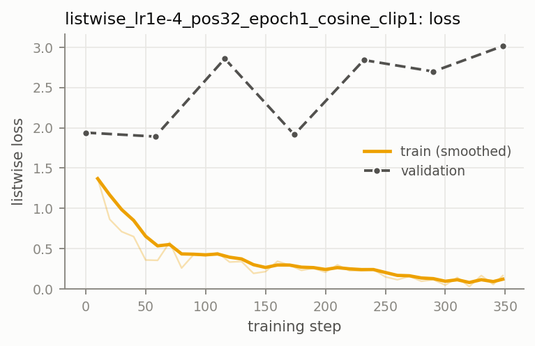 | 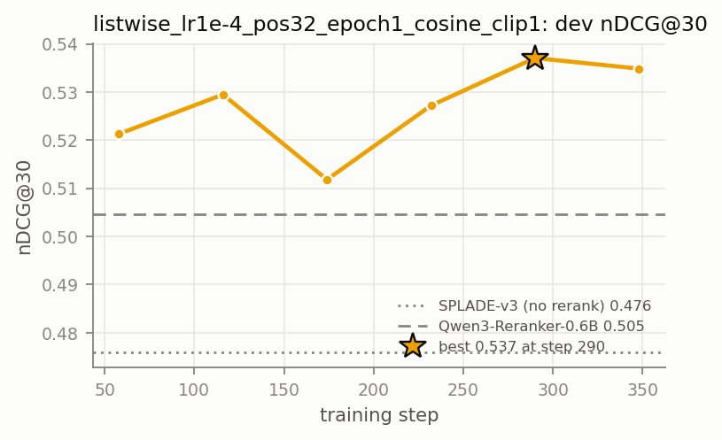 |

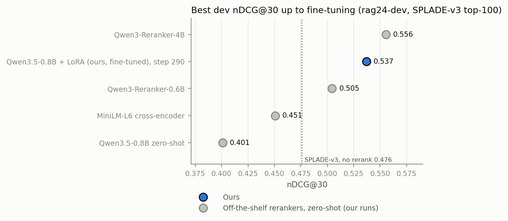

Averaging step 290 with its neighbors (`listwise_lr1e-4_pos32_epoch1_cosine_clip1_avg3_ckpts`) gives 0.533, below step 290 alone.

## Data Augmentation and Distillation

A larger Qwen3.5 teacher supplies soft scores and labels for the sparse RAG24 training data.
The student and its training configuration stay as selected in [Fine-tuning](#fine-tuning).

### 1. Teacher Gate

Zero-shot Qwen3.5 teachers on `rag24-dev`, SPLADE-v3 top-100. A teacher must clearly beat the student (about 0.56 vs 0.537).

| Teacher | Prompt | nDCG@30 | Recall@30 |
|---|---|---|---|
| Qwen3.5-9B | graded 0–3 (expected grade) | 0.528 | 0.155 |
| Qwen3.5-35B-A3B-GPTQ-Int4 | yes/no margin | 0.542 | 0.156 |
| Qwen3.5-9B | yes/no margin | 0.548 | 0.166 |
| Qwen3.5-35B-A3B-GPTQ-Int4 | graded 0–3 (expected grade) | 0.557 | 0.160 |
| **Qwen3.5-9B yes/no + 35B-A3B graded** | sum of per-topic z-scores | **0.572** | **0.168** |
| *student: `listwise_lr1e-4_pos32_epoch1_cosine_clip1`, step 290* | *fine-tuned yes/no margin* | *0.537* | *0.164* |

- No single teacher clears the gate. The two-teacher ensemble does (+0.035 over the student) and becomes the teacher.
- The two models err differently: each prefers a different prompt, and their sum beats both. A third scorer adds at most 0.003.
- Scoring runs through vLLM in float16, which matches the float32 student scorer (0.549 vs 0.548 for the 9B yes/no margin).

### 2. Score Cache

Both teachers score the SPLADE-v3 top-100 of all 212 `rag24-train` topics, plus every document in the training groups:
34,461 pairs, about 50 minutes. Caches live in `outputs/llm_reranking/teachers/<topics>/`, one per teacher plus the ensemble.

- 7,493 pairs (35%) have no UMBRELA label; only the teacher scores them. They are the augmentation pool.
- Against UMBRELA labels, the ensemble ranks train topics at 0.631 nDCG@30 (SPLADE-v3: 0.497).
- Decontamination is applied when groups are built: no RAG25-like topics or RAG25-judged segments.
- All 16,441 group documents have a teacher score.

### 3. Distillation

Same groups and configuration as `listwise_lr1e-4_pos32_epoch1_cosine_clip1`; only the loss changes:
`α · listwise CE + (1 − α) · τ² · KL(teacher ‖ student)` over each group of 8, with the ensemble's z-scores as teacher logits.
Borrowed negatives from other topics (64 groups) get the group's lowest teacher score.

| Run | Best dev nDCG@30 (step) | Recall@30 | Best dev loss (step) |
|---|---|---|---|
| `listwise_lr1e-4_pos32_epoch1_cosine_clip1_distill_alpha0.5_tau1` | 0.538 (348) | 0.162 | 1.41 (174) |
| `listwise_lr1e-4_pos32_epoch1_cosine_clip1_distill_alpha0_tau2` | 0.538 (348) | 0.162 | 1.43 (174) |
| `listwise_lr1e-4_pos32_epoch1_cosine_clip1_distill_alpha0.5_tau2` | 0.541 (290) | **0.164** | **1.39** (174) |
| **`listwise_lr1e-4_pos32_epoch1_cosine_clip1_distill_alpha0_tau1`** | **0.542** (290) | 0.161 | 1.47 (290) |
| `listwise_lr1e-4_pos32_epoch1_cosine_clip1` (no distillation) | 0.537 (290) | **0.164** | 1.89 (58) |
| *teacher: Qwen3.5-9B yes/no + 35B-A3B graded* | *0.572* | *0.168* | |

- Every distillation setting beats the plain run (0.538–0.542 vs 0.537), and pure distillation at τ = 1 is best (+0.005).
- Distillation steadies training: the four settings differ by only 0.004, and the last three checkpoints of each stay within 0.006 (plain run: 0.010).
- Dev loss drops from 1.89 to 1.39–1.47, below every run in [Full Data](#3-full-data-training-configuration), and stays low.
  The plain run's dev loss swings between 1.89 and 3.01; soft targets keep margins calibrated.
- The gap to the teacher (0.03) stays. On the existing groups the teacher mostly confirms UMBRELA labels:
  7 judged negatives per positive leave little ordering to learn. Its signal lies in the 7,493 unjudged pairs, which augmentation uses.

### 4. Augmentation

Pure distillation (α = 0, τ = 1) on groups of 16: 1 positive, 8 unjudged segments, and 7 judged negatives.
The unjudged segments come from the topic's SPLADE-v3 top-100, up to 32 per topic in rank order, with no RAG25-judged segments;
each group samples 8. Only the teacher scores them. Updates still hold 16 groups (4 per micro-batch × 4 accumulation steps).

The teacher is too noisy to turn unjudged segments into hard labels. On the 5,032 judged dev pairs in the top-100,
its precision for grade ≥ 2 peaks near 0.64 (z ≥ 3; base rate 0.43) and for grade 0 near 0.43 (z ≤ −2.5; base rate 0.25).
So no extra positives are added, and unjudged segments enter only as soft-scored group members:

- Unfiltered: 5,750 segments over 198 topics, at least 13 per topic.
- z ≤ 0 (teacher scores the segment below its topic's mean): 3,949 segments; 16 topics have fewer than 8, and judged negatives fill the rest.

| Run | Best dev nDCG@30 (step) | Recall@30 | Best dev loss (step) |
|---|---|---|---|
| **`listwise_lr1e-4_pos32_epoch1_cosine_clip1_distill_alpha0_tau1_group16_unjudged8`** | **0.549** (290) | **0.165** | 1.44 (348) |
| `listwise_lr1e-4_pos32_epoch1_cosine_clip1_distill_alpha0_tau1_group16_unjudged8_z0` | 0.547 (174) | 0.163 | 1.44 (174) |
| `listwise_lr1e-4_pos32_epoch1_cosine_clip1_distill_alpha0_tau1` (groups of 8, judged only) | 0.542 (290) | 0.161 | 1.47 (290) |
| `listwise_lr1e-4_pos32_epoch1_cosine_clip1` (no distillation) | 0.537 (290) | 0.164 | 1.89 (58) |
| *teacher: Qwen3.5-9B yes/no + 35B-A3B graded* | *0.572* | *0.168* | |

- Unjudged segments help: +0.007 over distillation on judged groups and +0.012 over the plain run, closing about a third of the plain run's gap to the teacher (0.035).
- Filtering to z ≤ 0 does not help (0.547 vs 0.549). Soft targets already give likely-relevant unjudged segments a high score,
  so they need no removal; dropping them only shrinks the pool.
- Both runs stay steady: the last three checkpoints span 0.005 (unfiltered) and 0.004 (z ≤ 0).

### 5. Dev Results

The best system of each step joins the fine-tuning result: the teacher ensemble (zero-shot), the distilled model, and the distilled + augmented model.

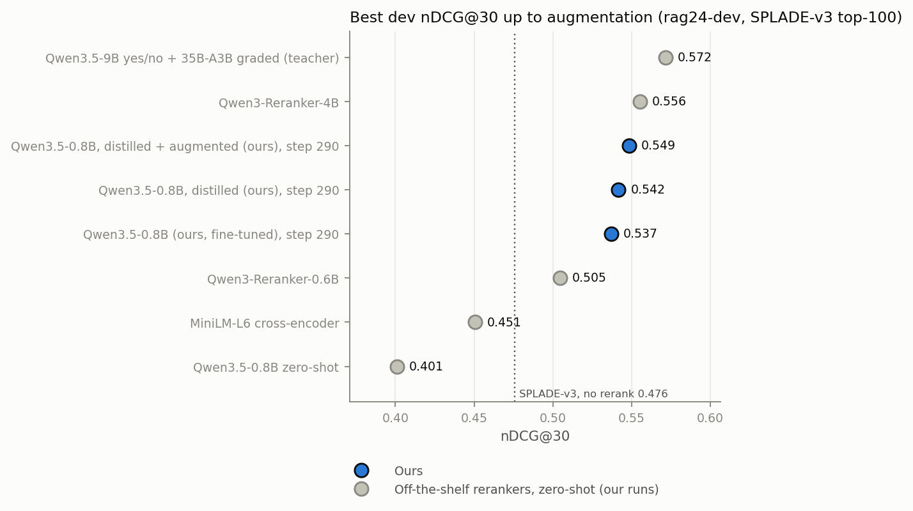

## Fusion

Our reranker is fused with other scorers over the same SPLADE-v3 top-100, with RRF constant 60 and equal weights.

| `rag24-dev` | RRF nDCG@30 | z-score sum nDCG@30 |
|---|---|---|
| ours alone | 0.537 | |
| teacher ensemble alone | 0.572 | |
| ours + teacher ensemble | 0.581 | 0.581 |
| ours + Qwen3.5-9B yes/no + 35B-A3B graded (three members) | 0.586 | 0.585 |
| ours + teacher ensemble + SPLADE-v3 | **0.588** | 0.587 |
| ours + Qwen3.5-9B yes/no + SPLADE-v3 | 0.580 | 0.576 |
| ours + Qwen3.5-9B yes/no | 0.571 | 0.567 |
| ours + SPLADE-v3 | 0.552 | 0.548 |

- Ours and the teacher err differently: their fusion beats both. RRF and z-score sums agree within 0.004, so RRF stays.
- The best fusion, ours + teacher ensemble + SPLADE-v3 (0.588), goes to RAG25. Adding SPLADE-v3 or splitting the ensemble
  into its two models changes the score by under 0.01.
- First-stage fusion of BM25 and SPLADE-v3 lowers dev Recall@100 from 0.331 to 0.300, so SPLADE-v3 stays the first stage.

On RAG25 (SPLADE-v3 top-100, paired randomization tests on per-topic nDCG@30):

| RAG25 | nDCG@30 | nDCG@100 | Δ vs ours (won / lost, p) |
|---|---|---|---|
| ours | 0.650 | 0.557 | |
| **RRF: ours + teacher ensemble + SPLADE-v3** | **0.665** | **0.561** | +0.015 (12 / 7, 0.18) |

- The teacher alone does not transfer: 0.035 above ours on dev, 0.034 below on RAG25 (0.616, see [Test Results](#test-results)).
  Fused with ours and SPLADE-v3, it still helps: +0.015 over ours, winning 12 of 22 topics, but not significant.
- The fusion beats the teacher alone (+0.049, p = 0.001), SPLADE-v3 (+0.069, p < 0.001) and Qwen3-Reranker-4B (+0.073, p < 0.001),
  and is level with RankQwen3-32B (+0.019, p = 0.19). It would rank 4th of 47 R-task runs.
- Cost: two teacher passes over every candidate, Qwen3.5-9B and 35B-A3B (3B active parameters).

### Dev Results

The best fusion joins the previous figure.

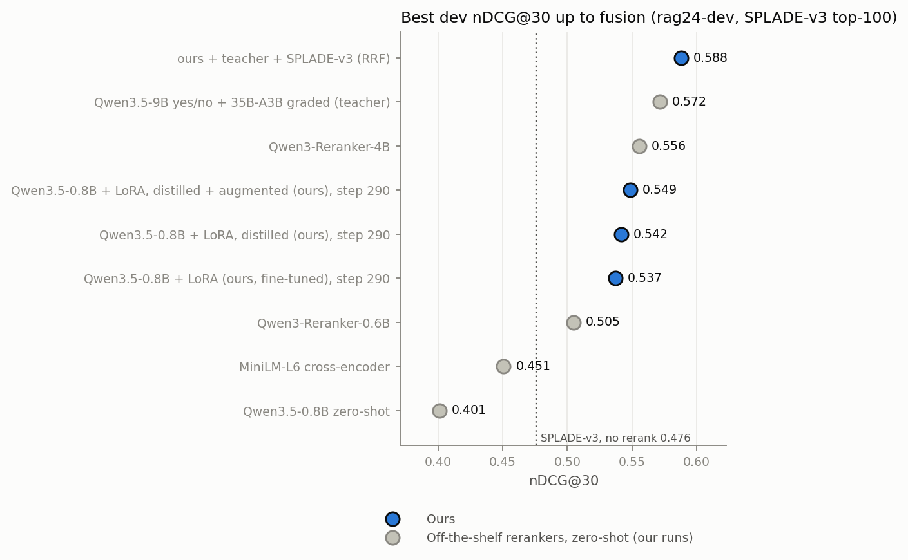

## Listwise LLM Reranking

Zero-shot Qwen3.5 reorders the top-100 in windows of 20 with stride 10, back to front (RankGPT / RankZephyr prompt,
thinking off, passages cut to 256 tokens). Missing or repeated ids in an output keep their previous order.
The window starts from either the SPLADE-v3 order or our fine-tuned reranker's order.

| `rag24-dev` | nDCG@30 | Recall@30 | Incomplete outputs (of 801) | s/query |
|---|---|---|---|---|
| Qwen3.5-9B, from SPLADE-v3 | 0.546 | 0.162 | 43 | 3.7 |
| Qwen3.5-35B-A3B, from SPLADE-v3 | 0.559 | 0.164 | 14 | 2.0 |
| Qwen3.5-9B, from ours | 0.560 | 0.166 | 50 | 3.8 |
| **Qwen3.5-35B-A3B, from ours** | **0.565** | **0.170** | 25 | 2.0 |
| *ours (fine-tuned)* | *0.537* | *0.164* | | *0.58* |
| *teacher ensemble (pointwise)* | *0.572* | *0.168* | | |

- The 35B-A3B model is better and, as a mixture of experts with 3B active parameters, about twice as fast as the 9B.
  Times are vLLM batches over all topics; ours runs one topic at a time.
- Starting from our order helps listwise alone (+0.006 for 35B-A3B), but fuses worse: RRF of ours + listwise
  gives 0.567 from our order and 0.587 from the SPLADE-v3 order. An independent start keeps the errors apart.

| `rag24-dev`, RRF | nDCG@30 |
|---|---|
| ours + teacher ensemble + SPLADE-v3 ([Fusion](#fusion) best) | 0.588 |
| ours + Qwen3.5-9B + SPLADE-v3 | 0.580 |
| ours + listwise 35B-A3B (from SPLADE-v3) | 0.587 |
| ours + listwise 35B-A3B (from ours) + Qwen3.5-9B + SPLADE-v3 | 0.590 |
| **ours + listwise 35B-A3B (from SPLADE-v3) + Qwen3.5-9B** | **0.598** |

Two systems go to RAG25: listwise 35B-A3B from ours (best listwise system) and the best fusion (+0.010 over the [Fusion](#fusion) best on dev).

| RAG25 | nDCG@30 | nDCG@100 | Δ vs ours (won / lost, p) |
|---|---|---|---|
| ours | 0.650 | 0.557 | |
| listwise 35B-A3B, from ours | 0.625 | 0.544 | −0.025 (6 / 14, 0.053) |
| **RRF: ours + listwise 35B-A3B (from SPLADE-v3) + Qwen3.5-9B** | **0.664** | **0.559** | +0.014 (9 / 8, 0.16) |

- Like the pointwise teachers, zero-shot listwise Qwen3.5 does not transfer: above ours on dev, below on RAG25.
  Applied after ours, it lowers our ranking (p = 0.053).
- As a fusion member it helps: 0.664, +0.014 over ours (p = 0.16), and level with the [Fusion](#fusion) best
  (0.665, p = 0.96). It beats SPLADE-v3 (+0.069, p = 0.003) and Qwen3-Reranker-4B (+0.073, p < 0.001),
  and is level with RankQwen3-32B (+0.018, p = 0.28). It would still rank 4th of 47 R-task runs.
- Cost: two LLM passes beyond ours, 9 listwise windows per topic (about 2 s) and a 9B pointwise pass.

### Dev Results

The best listwise system and the best fusion join the previous figure.

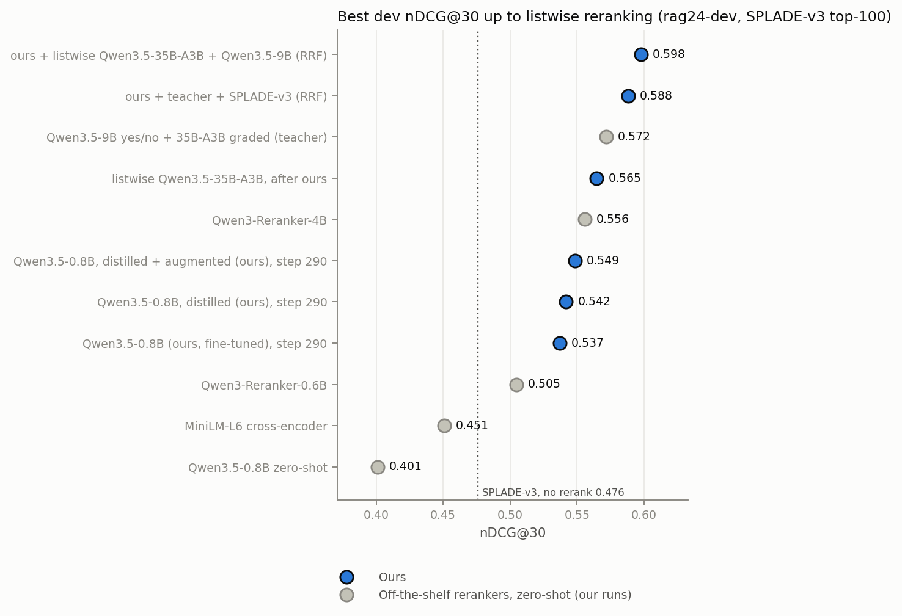

## Cascades

Fusion runs every LLM on every candidate. A cascade spends LLM compute only on the top of our ranking:
ours reranks the SPLADE-v3 top-D (D = 100, 500), then a final stage reorders its top-k (k = 30, 100):
listwise Qwen3.5-35B-A3B from our order, or the [listwise](#listwise-llm-reranking) best fusion
(RRF of ours + listwise 35B-A3B from the SPLADE-v3 order + pointwise Qwen3.5-9B). Documents below k keep our order.
Cost is the sum of each component's seconds per query on one RTX 5090, model loading excluded.
Cascades are evaluated on dev only.

| `rag24-dev` | nDCG@30 | Recall@30 | Judged@30 | s/query |
|---|---|---|---|---|
| **ours, top-100** | **0.537** | 0.164 | 0.77 | 0.53 |
| **top-100, listwise@30** | **0.553** | 0.164 | 0.77 | 0.98 |
| **top-100, fusion@30** | **0.565** | 0.164 | 0.77 | 1.88 |
| top-100, listwise@100 | 0.562 | 0.169 | 0.78 | 2.51 |
| ours, top-500 | 0.486 | 0.143 | 0.66 | 2.52 |
| top-500, listwise@30 | 0.516 | 0.143 | 0.66 | 2.96 |
| top-500, fusion@30 | 0.517 | 0.143 | 0.66 | 3.88 |
| top-500, listwise@100 | 0.555 | 0.168 | 0.71 | 4.54 |
| **top-100, fusion@100** | **0.596** | 0.175 | 0.81 | 5.57 |
| **top-500, fusion@100** | **0.599** | 0.185 | 0.78 | 7.54 |

Bold: the dev Pareto front. Judged@30 is the share of the top 30 with a NIST judgment; unjudged documents count as non-relevant.

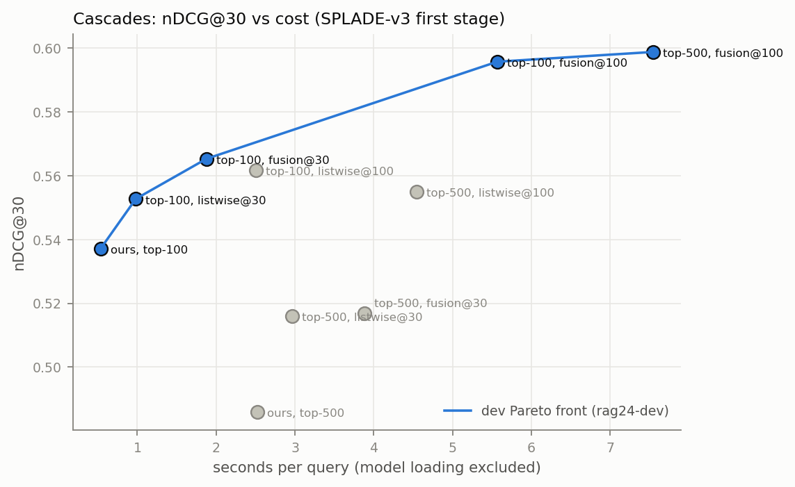

- Most of the gain is cheap: a final stage on the top 30 adds 0.016 (listwise, +0.45 s) or 0.028 (fusion, +1.35 s).
  Fusion on the top 100 adds another 0.031 for 3.7 s more.
- Fusion beats listwise at every k, and its members gain most from seeing all 100 candidates.
- Reranking the top 500 with ours costs 2.0 s more and lowers nDCG@30 to 0.486. Its top 30 is 11 points less judged (0.66 vs 0.77),
  so part of the drop is unjudged documents rather than worse rankings; dev cannot tell the two apart.
  With fusion on the top 100, the deeper list recovers (0.599, +0.003 over top-100) at 2 s more.
- Component costs: ours 0.53 s per 100 documents (2.5 s for 500); listwise 35B-A3B 0.22 s per window
  (2 windows for the top 30, 9 for the top 100); pointwise 9B about 0.03 s per document.

## Test Results

RAG25, 22 NIST-judged topics, SPLADE-v3 top-100. R@100 is 0.2105 for every reranked row.
Each section sends only its dev-selected systems to RAG25.

| System | nDCG@30 | nDCG@100 |
|---|---|---|
| SPLADE-v3, no rerank | 0.596 | 0.539 |
| MiniLM-L6 cross-encoder | 0.532 | 0.522 |
| Qwen3.5-0.8B zero-shot | 0.538 | 0.524 |
| Qwen3-Reranker-0.6B | 0.585 | 0.536 |
| Qwen3-Reranker-4B | 0.592 | 0.542 |
| Qwen3.5-9B yes/no + 35B-A3B graded, zero-shot (teacher, [Teacher Gate](#1-teacher-gate)) | 0.616 | 0.546 |
| Qwen3.5-0.8B + LoRA (ours, fine-tuned) | 0.650 | 0.557 |
| Qwen3.5-0.8B + LoRA, distilled (ours, [Distillation](#3-distillation)) | 0.605 | 0.546 |
| Qwen3.5-0.8B + LoRA, distilled + augmented (ours, [Augmentation](#4-augmentation)) | 0.635 | 0.553 |
| **ours + teacher + SPLADE-v3 (RRF, [Fusion](#fusion))** | **0.665** | **0.561** |
| Qwen3.5-35B-A3B listwise, zero-shot, after ours ([Listwise](#listwise-llm-reranking)) | 0.625 | 0.544 |
| ours + listwise Qwen3.5-35B-A3B + Qwen3.5-9B (RRF, [Listwise](#listwise-llm-reranking)) | 0.664 | 0.559 |
| *overview* `rag25_test_rankqwen3` (RankQwen3-32B, SPLADE-v3 + Arctic-L top-1000) | 0.646 | 0.584 |
| *overview* best run (`4method_merge`) | 0.693 | 0.613 |

Paired randomization tests on per-topic nDCG@30, for the fine-tuned model:

| Ours vs | Δ nDCG@30 | Topics won / lost | p |
|---|---|---|---|
| SPLADE-v3 | +0.054 | 17 / 4 | 0.009 |
| Qwen3-Reranker-0.6B | +0.065 | 17 / 5 | 0.003 |
| Qwen3-Reranker-4B | +0.058 | 18 / 4 | 0.004 |
| RankQwen3-32B (organizers) | +0.004 | 13 / 8 | 0.80 |

- The 0.8B reranker matches the organizers' 32B reranker on nDCG@30 and would rank 6th of 47 R-task runs.
- Its recall is capped by the SPLADE-v3 top-100 (0.2105). RankQwen3-32B reranks a fused top-1000 (R@100 0.2274), which explains most of the nDCG@100 gap.
- Qwen3-Reranker gains little on RAG25 narratives, and zero-shot Qwen3.5 hurts. Fine-tuning on RAG24 transfers.
- Distillation does not transfer. The distilled model (dev 0.542) scores 0.605, significantly below the fine-tuned one
  (−0.046, won / lost 3 / 18, p = 0.001) and level with SPLADE-v3 (+0.009, p = 0.66).
- Augmentation recovers part of the gap. The distilled + augmented model (dev 0.549) scores 0.635: 0.015 below
  the fine-tuned one (8 / 14, p = 0.26), above SPLADE-v3 (+0.040, p = 0.049) and Qwen3-Reranker-4B (+0.044, p = 0.011),
  and level with RankQwen3-32B (−0.011, p = 0.51).
- The teacher ensemble, best on dev (0.572), scores 0.616: below the fine-tuned model (−0.034, p = 0.031), level with SPLADE-v3 (+0.020, p = 0.36).
- RRF fusions are our best (0.665 and 0.664): see [Fusion](#fusion) and [Listwise LLM Reranking](#listwise-llm-reranking).

## Notes

- P(yes) saturates near 0 and 1, and bf16 logits keep about three digits, which left over half of reranked documents tied.
  Scoring the margin in float32 fixed this before the final test.
- The RAG25 log also holds early rounds and runs of systems not selected on dev; only dev-selected systems are reported.
- Our runs were not in the RAG25 judgment pool, so unjudged segments count as non-relevant and our scores are conservative.
- RAG24 topics are short questions. RAG25 topics are multi-sentence narratives.
- With 22 test topics, differences below about 0.03 are rarely significant.

## Findings

Every choice is made on `rag24-dev`; only each step's dev-selected systems are tested on RAG25, once.

1. **Stable training.** Goal: a smooth dev curve, low checkpoint variance, and a higher best score.
   Baseline: `listwise_lr5e-5_pos8_epoch3`, the best small-data run (dev nDCG@30 0.534).
   Few, noisy labels let yes/no margins grow without bound, and nearly every update is clipped (gradient norm 13–19 vs a 1.0 threshold).
   We compared complete configurations ([step 2](#2-small-data-loss-and-learning-rate), [step 3](#3-full-data-training-configuration)):

   | Category | Tried | Result (best dev nDCG@30) |
   |---|---|---|
   | Data and length | 8 positives per topic × 3 epochs vs 32 × 1 epoch | 32 × 1 epoch: 0.537, the only gain (+0.003) |
   | Schedule | cosine vs WSD | cosine 0.537; WSD 0.532 and swings across checkpoints |
   | Optimizer | AdamW β2 0.999 vs 0.95 with weight decay | 0.95 + weight decay: 0.530 |
   | Gradient clipping | max norm 1.0, 10, none | 1.0 best (0.537); none 0.533 with the lowest dev loss; 10 is worst (0.523) |
   | Precision | bf16 weights, float32 scoring head | float32 removes ties that bf16 logits caused for over half of the documents |
   | Score control | z-loss, soft-cap, temperature, label smoothing | 0.526–0.532; z-loss and smoothing bound margins most |
   | Weight averaging | EMA; best checkpoint with its two neighbors | EMA 0.527 with the flattest curve; averaging 0.533 |
   | LoRA | LoRA+ (B at 4× LR) | LoRA+ 0.522, slowest start |
   | Combinations | no clipping + z-loss, + β2 0.95 and weight decay | 0.532 and 0.529 |

   - Best setting: 32 positives per topic, one epoch, cosine schedule, clipping at 1.0 (`listwise_lr1e-4_pos32_epoch1_cosine_clip1`).
     It lifts the baseline from 0.534 to 0.537. More distinct training groups matter more than any optimizer or loss change,
     though the gain is small.
   - Stabilizers work as intended: z-loss and no clipping keep dev loss below the untrained 1.94 and bound margins,
     and EMA flattens the late curve. Their final scores stay within 0.522–0.533, close to each other and to the baseline.

2. **Data augmentation and distillation.** RAG24 has sparse labels: about 7 judged negatives per positive, and most top-100 segments are unjudged.
   A larger Qwen3.5 teacher supplies soft scores for judged and unjudged segments
   ([Data Augmentation and Distillation](#data-augmentation-and-distillation)):

   | Step | Result (best dev nDCG@30) |
   |---|---|
   | Teacher gate | Qwen3.5-9B yes/no + 35B-A3B graded ensemble: 0.572, +0.035 over the student; no single teacher clears it |
   | Distillation on judged groups | 0.538–0.542 over α ∈ {0.5, 0}, τ ∈ {1, 2}; best pure distillation at τ = 1 |
   | Augmentation | 8 unjudged top-100 segments per group of 16: 0.549; keeping only z ≤ 0 gives 0.547 |

   - On dev, each step helps: 0.537 → 0.542 → 0.549, with steadier checkpoints and dev loss down from 1.89 to 1.44.
   - The teacher is too noisy for hard labels (precision at most 0.64 for positives), so unjudged segments enter only with soft scores.
   - On RAG25 the gains do not transfer: distillation gives 0.605, significantly below the plain run's 0.650 (p = 0.001),
     and augmentation 0.635 (p = 0.26). Unjudged segments recover part of the loss.
     A likely cause: the teacher is gated on RAG24-style questions, and its advantage may not hold on RAG25 narratives.
     The plain run stays our reranker.

3. **Fusion.** Our reranker is fused with larger zero-shot scorers by RRF ([Fusion](#fusion)).
   - Reranker stage: ours + the Qwen3.5 teacher ensemble reaches 0.581 on dev (ours 0.537, teacher 0.572); RRF and z-score sums agree.
   - First stage: BM25 + SPLADE-v3 lowers recall, so SPLADE-v3 stays.
   - The best dev fusion, ours + teacher ensemble + SPLADE-v3 (0.588), scores 0.665 on RAG25: +0.015 over ours (p = 0.18), 4th of 47.
     The teacher alone falls to 0.616 there, below ours.
   - Dev favors the teacher, RAG25 favors our reranker. Fusion hedges across that shift,
     but its gain is not significant and it costs two teacher passes.

4. **Listwise LLM reranking with a sliding window.** Zero-shot Qwen3.5 reorders the top-100 in windows of 20
   with stride 10, back to front, as in RankGPT and RankZephyr ([Listwise LLM Reranking](#listwise-llm-reranking)).

   | Step | Tried | Result (dev nDCG@30) |
   |---|---|---|
   | Model | Qwen3.5-9B vs 35B-A3B (3B active) | 35B-A3B better (0.559–0.565 vs 0.546–0.560) and twice as fast (2.0 vs 3.7 s/query) |
   | Starting order | SPLADE-v3 vs our reranker | ours better alone (0.565); SPLADE-v3 a better fusion member (0.587 vs 0.567 with ours) |
   | Fusion | RRF with ours, SPLADE-v3, pointwise 9B, teacher ensemble | ours + listwise 35B-A3B (from SPLADE-v3) + 9B: 0.598, best on dev |

   - Direct use: listwise 35B-A3B after ours gives 0.565 on dev but 0.625 on RAG25, below ours (0.650, p = 0.053).
     Like the pointwise teachers, zero-shot Qwen3.5 rankers look strong on RAG24 questions and weak on RAG25 narratives.
   - As a fusion member it helps: 0.664 on RAG25 (+0.014 over ours, p = 0.16), level with point 3's fusion (0.665).
     It costs two LLM passes beyond ours: 9 listwise windows per topic and a pointwise 9B pass.
   - Output parsing is robust: 2–6% of window outputs miss or repeat ids, and the missing ones keep their order.

5. **Cascades under a cost budget.** Fusion runs every LLM on every candidate; a cascade spends LLM compute only on
   the top of our ranking ([Cascades](#cascades)). Ours reranks the SPLADE-v3 top-100 or top-500, then listwise 35B-A3B
   or the listwise fusion reorders its top 30 or top 100. All results are on dev:

   | Budget (s/query) | Best dev system | nDCG@30 |
   |---|---|---|
   | 0.5 | ours alone | 0.537 |
   | 1 | + listwise 35B-A3B on the top 30 | 0.553 |
   | 2 | + fusion on the top 30 | 0.565 |
   | 6 | + fusion on the top 100 | 0.596 |
   | 7.5 | ours on the top 500, + fusion on the top 100 | 0.599 |

   - Most of the gain is cheap: a final stage on the top 30 gives about half of the fusion gain at a third of its cost.
   - Fusion beats listwise at every cut-off, as in points 3 and 4.
   - Deeper candidates do not pay on dev: ours on the top 500 drops to 0.486, partly because more of its top 30 is unjudged.

**Overall.**
- Fine-tuning a 0.8B reranker on RAG24 transfers best: 0.650 on RAG25, level with the organizers' 32B reranker.
- Zero-shot Qwen3.5 scorers (pointwise teachers, listwise) and students distilled from them gain on dev but lose on RAG25.
  RAG24 questions and RAG25 narratives differ, and dev cannot see that shift.
- Fusion is the robust way to use the larger models: ours + LLM scorers by RRF reaches 0.665 on RAG25 (+0.015, not significant).
- Under a cost budget, an LLM stage on only the top 30 gets about half of the fusion gain at a third of its cost (dev).

## Reproduce

```bash
python -m retrieval_ranking_lab run --topics rag24-dev --retriever splade --k-retrieve 1000
python -m retrieval_ranking_lab run --topics rag25 --retriever splade --k-retrieve 1000

python -m studies.llm_reranking.build_data --split rag24-train
python -m studies.llm_reranking.build_data --split rag24-dev --no-decontaminate \
    --max-positives-per-topic 8 --max-negatives-per-topic 7 --out data/reranker_train/rag24-dev-val.jsonl

python -m studies.llm_reranking.build_data --split rag24-train --max-positives-per-topic 8 \
    --out data/reranker_train/rag24-train-pos8.jsonl

# small data: train, then score every checkpoint on dev as in run_full_data_sweep.sh
python -m studies.llm_reranking.train --data data/reranker_train/rag24-train-pos8.jsonl \
    --dev-data data/reranker_train/rag24-dev-val.jsonl --epochs 3 --save-every 48 \
    --loss-type pointwise --out checkpoints/reranker/pointwise_lr1e-4_pos8_epoch3
# likewise listwise_lr1e-4_pos8_epoch3, and listwise_lr5e-5_pos8_epoch3 with --learning-rate 5e-5

# full data: every configuration, trained and scored on dev
studies/llm_reranking/run_full_data_sweep.sh

python -m studies.llm_reranking.evaluate --topics rag25 \
    --rerankers lora:checkpoints/reranker/listwise_lr1e-4_pos32_epoch1_cosine_clip1/step-290

python -m studies.llm_reranking.plot_results --overlay-runs 3 \
    --run-dir checkpoints/reranker/listwise_lr1e-4_pos8_epoch3 --run-dir checkpoints/reranker/pointwise_lr1e-4_pos8_epoch3 \
    --run-dir checkpoints/reranker/listwise_lr5e-5_pos8_epoch3 --run-dir checkpoints/reranker/listwise_lr1e-4_pos32_epoch1_cosine_clip1
python -m studies.llm_reranking.plot_full_data_sweep

# teacher gate: zero-shot Qwen3.5 teachers on dev
studies/llm_reranking/run_teacher_gate.sh

# teacher score cache for rag24-train, then the two-teacher ensemble (dev and train)
studies/llm_reranking/run_teacher_scores.sh
for topics in rag24-dev rag24-train; do
  python -m studies.llm_reranking.ensemble_teachers --topics $topics --name ensemble_9b-yes_no_35b-a3b-graded \
    --teacher Qwen3.5-9B_yes_no --teacher Qwen3.5-35B-A3B-GPTQ-Int4_graded
done

# distillation: four alpha/tau settings on the existing groups, trained and scored on dev
studies/llm_reranking/run_distillation.sh

# augmentation: groups of 16 with unjudged top-100 segments (unfiltered and z <= 0), trained and scored on dev
studies/llm_reranking/run_augmentation.sh
python -m studies.llm_reranking.evaluate --topics rag25 \
    --rerankers lora:checkpoints/reranker/listwise_lr1e-4_pos32_epoch1_cosine_clip1_distill_alpha0_tau1_group16_unjudged8/step-290

# fusion: dev grid, BM25 + SPLADE-v3 first stage, teachers on RAG25, then the dev-best fusion on RAG25
studies/llm_reranking/run_fusion.sh

# listwise: four variants on dev, then the best listwise system and the dev-best fusion on RAG25
studies/llm_reranking/run_listwise.sh

# cascades: every system on dev, then the frontier figure
studies/llm_reranking/run_cascade.sh rag24-dev
python -m studies.llm_reranking.plot_cascades

# average the best checkpoint with its neighbors, then score it on dev
python -m studies.llm_reranking.average_checkpoints \
    --checkpoint checkpoints/reranker/listwise_lr1e-4_pos32_epoch1_cosine_clip1/step-232 \
    --checkpoint checkpoints/reranker/listwise_lr1e-4_pos32_epoch1_cosine_clip1/step-290 \
    --checkpoint checkpoints/reranker/listwise_lr1e-4_pos32_epoch1_cosine_clip1 \
    --out checkpoints/reranker/listwise_lr1e-4_pos32_epoch1_cosine_clip1_avg3_ckpts
python -m studies.llm_reranking.evaluate --topics rag24-dev --name listwise_lr1e-4_pos32_epoch1_cosine_clip1_avg3_ckpts \
    --rerankers lora:checkpoints/reranker/listwise_lr1e-4_pos32_epoch1_cosine_clip1_avg3_ckpts
```

## Reference

### Papers, Reports and Blogs

- Qwen3 Embedding, source of Qwen3-Reranker (202506): [arXiv](https://arxiv.org/abs/2506.05176)
- RankLLM, LLM reranking toolkit (202505): [arXiv](https://arxiv.org/abs/2505.19284)
- UMBRELA, LLM relevance assessor (202406): [arXiv](https://arxiv.org/abs/2406.06519)
- RankZephyr, open listwise reranker (202312): [arXiv](https://arxiv.org/abs/2312.02724)
- RankLLaMA, fine-tuned LLM pointwise reranker (202310): [arXiv](https://arxiv.org/abs/2310.08319)
- RankGPT, zero-shot listwise reranking (202304): [arXiv](https://arxiv.org/abs/2304.09542)
- LoRA, low-rank adaptation (202106): [arXiv](https://arxiv.org/abs/2106.09685)
- Knowledge distillation, soft teacher targets (201503): [arXiv](https://arxiv.org/abs/1503.02531)
- monoT5, seq2seq reranker (202003): [arXiv](https://arxiv.org/abs/2003.06713)
- monoBERT, BERT cross-encoder reranker (201901): [arXiv](https://arxiv.org/abs/1901.04085)

### Code

- QwenLM/Qwen3-Embedding: [GitHub](https://github.com/QwenLM/Qwen3-Embedding)
- castorini/rank_llm: [GitHub](https://github.com/castorini/rank_llm)
- huggingface/peft: [GitHub](https://github.com/huggingface/peft)
