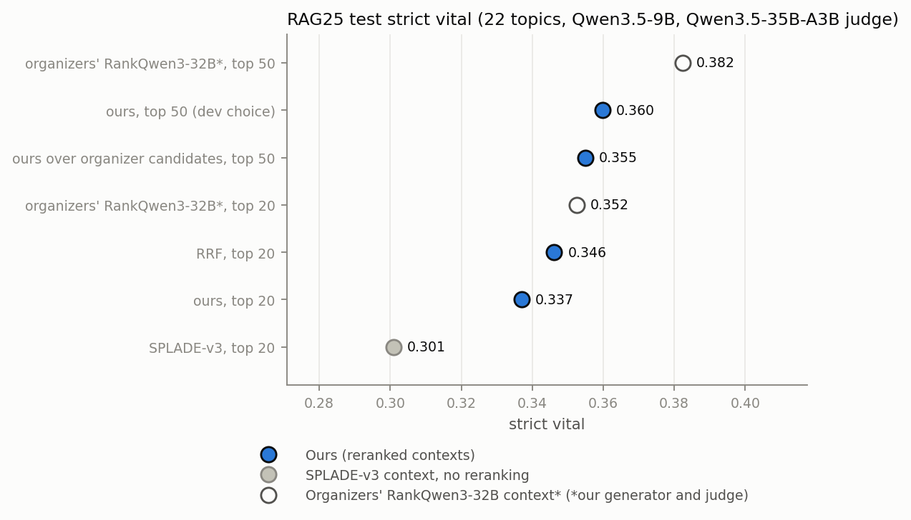
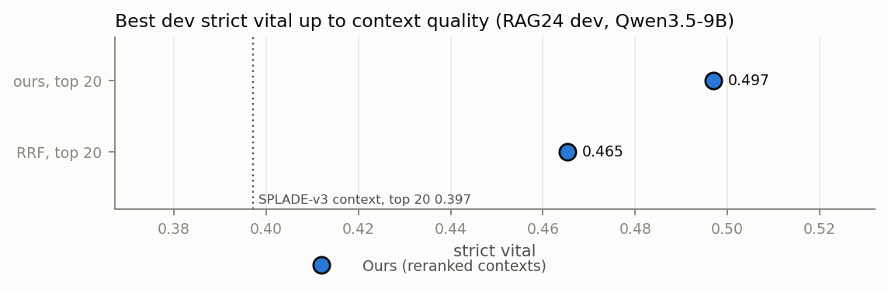
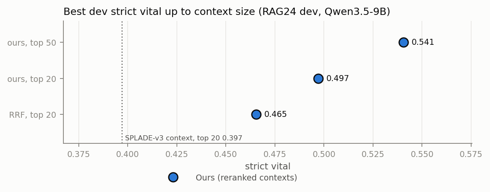
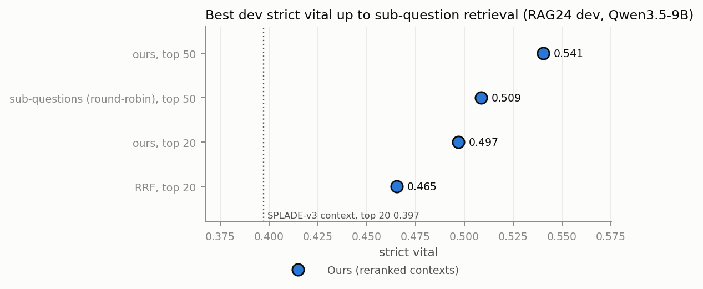

# Retrieval-Augmented Generation (RAG)

### Generating cited answers for complex search queries from reranked contexts, and improving their coverage through context size, document diversity, and sub-question retrieval.

The contexts come from the [LLM Reranking](../llm_reranking/README.md) study: SPLADE-v3, our fine-tuned Qwen3.5-0.8B reranker
("ours"), and its RRF fusion with zero-shot Qwen3.5 rerankers.

We generate cited answers for the narrative queries of TREC RAG 2025 with Qwen3.5-9B, using contexts from the reranking study,
and score them with a Qwen3.5-35B-A3B nugget judge checked against NIST assessors. Our best setup, the top 50 segments of our reranker,
reaches 0.360 strict vital on RAG25, level with the organizers' RankQwen3-32B context answered by our generator (0.382, p = 0.27).
Takeaways (details in [Findings](#findings)):

1. **Better retrieval gives better answers.** With the same generator, our reranker's context raises strict vital from 0.397 to 0.497
   over SPLADE-v3, and every reranked context also beats SPLADE-v3 on RAG25.
2. **A larger context helps more than a more diverse one.** The top 50 segments of our reranker raise strict vital from 0.483 to 0.541,
   while capping segments per document does not help.
3. **The remaining gap is in what the answer covers.** Every context misses the same 20% of sub-narratives,
   and higher-recall candidates do not give better answers.
4. **Citations are reliable.** Support precision stays at 0.82–0.89 for every context and every generator from 2B up.
5. **The judge can be trusted for comparisons.** It ranks systems almost as NIST assessors do (Kendall τ = 0.873),
   though it scores lower in absolute terms.



## Setup

- Contexts: the top segments of a run from the [LLM Reranking](../llm_reranking/README.md) study, 20 unless stated.
- Generator: Qwen3.5-9B. Judge: Qwen3.5-35B-A3B-GPTQ-Int4 for nuggets and citation support (see [Others](#others)).
- Dev set: the 56 RAG24 topics with track nuggets (CoverageBench release). They have no sub-narratives.
- Test set: the 22 RAG25 topics with post-edited nuggets, used once per condition and never for tuning.
- Paired randomization tests use per-topic strict vital. Rerunning an identical condition changes strict vital by up to 0.018,
  so a dev step is kept only if it gains at least 0.02.

## Metrics

- `strict_vital`: vital nuggets fully supported by the answer (overview Table 8).
- `vital`: the same, with partial support counted as 0.5.
- `subnarrative_coverage`: sub-narratives with at least one fully supported nugget (RAG25 only).
- `support_precision`, `support_recall`: support of each sentence's first citation, weighted 1 / 0.5 / 0 (overview Table 12).

## Baseline

The organizers' RankQwen3-32B run is the official AG input on RAG25. With our generator and judge, it links our scores to the
overview and is the baseline that the final [test results](#test-results) are compared with.

| RankQwen3-32B context | strict_vital | vital | subnarrative_coverage | support_precision | support_recall |
|---|---|---|---|---|---|
| top 20, our generator and judge | 0.353 | 0.450 | 0.621 | 0.880 | 0.846 |
| top 50, our generator and judge | 0.373 | 0.461 | 0.664 | 0.832 | 0.793 |
| *overview* `rag25_qwen3_20_ag` | 0.45 | | 0.78 | 0.568 | 0.508 |
| *overview* `rag25_qwen3_50_ag` | 0.47 | | 0.80 | 0.468 | 0.373 |

- Absolute scores differ because the overview's assessors are GPT-4.1 (nuggets) and GPT-OSS-120B (support).
- The trends match: a top-50 context raises nugget scores (+0.019 strict vital, p = 0.39) and lowers support (−0.048, p = 0.070).

## Context Quality

Qwen3.5-9B answers from the top 20 segments of each context run. Ours is the [fine-tuned reranker](../llm_reranking/README.md#4-dev-results),
and the RRF is the [listwise fusion](../llm_reranking/README.md#listwise-llm-reranking) of ours, listwise Qwen3.5-35B-A3B, and Qwen3.5-9B.

On dev (56 topics):

| Context | strict_vital | vital | support_precision | support_recall |
|---|---|---|---|---|
| SPLADE-v3 | 0.397 | 0.492 | 0.869 | 0.812 |
| **ours** | **0.497** | **0.575** | 0.885 | 0.833 |
| RRF | 0.465 | 0.564 | **0.894** | 0.833 |

- Ours gains 0.100 strict vital over SPLADE-v3 (p = 0.007) and the RRF 0.068 (p = 0.045).
- Ours leads the RRF (+0.032, p = 0.42), so ours is the default context.
- Both rerankers were selected on `rag24-dev`, which contains these topics, so their gains may be slightly optimistic.

On test (22 topics), with each run's [nDCG@30](../llm_reranking/README.md#test-results) for reference:

| Context | nDCG@30 | strict_vital | vital | subnarrative_coverage | support_precision | support_recall |
|---|---|---|---|---|---|---|
| SPLADE-v3 | 0.596 | 0.301 | 0.388 | 0.567 | 0.888 | 0.861 |
| ours | 0.650 | 0.326 | 0.419 | 0.565 | 0.842 | 0.811 |
| RRF | 0.664 | 0.346 | 0.437 | 0.586 | 0.871 | 0.847 |
| organizers' RankQwen3-32B* | 0.646 | **0.352** | **0.460** | **0.636** | 0.884 | 0.852 |

\* The organizers' RankQwen3-32B context, answered and judged by our Qwen3.5-9B generator and Qwen3.5-35B-A3B judge instead of theirs.

- Every reranked context beats SPLADE-v3 on strict vital: ours by 0.025 (p = 0.30), the RRF by 0.045 (p = 0.013),
  and the organizers' context* by 0.051 (p = 0.042).
- The organizers' context* ranks lower than the RRF but covers more sub-narratives, because it reranks a higher-recall fused top-1000.



## Context Diversity and Size

Qwen3.5-9B answers on dev from the top 20, 30, and 50 segments of ours, with and without a cap of two segments per document.
The uncapped top 20 is rerun in the same batch as the reference.

| Context of ours | strict_vital | vital | support_precision | support_recall |
|---|---|---|---|---|
| top 20 (reference) | 0.483 | 0.566 | **0.884** | **0.837** |
| top 20, at most 2 per document | 0.496 | 0.573 | 0.869 | 0.820 |
| top 30 | 0.492 | 0.583 | 0.859 | 0.802 |
| top 30, at most 2 per document | 0.472 | 0.554 | 0.848 | 0.786 |
| **top 50** | **0.541** | **0.615** | 0.833 | 0.762 |
| top 50, at most 2 per document | 0.506 | 0.587 | 0.827 | 0.767 |

- The top 50 gains 0.058 strict vital over the top 20 (p = 0.036) and keeps support precision above 0.8.
- The per-document cap does not help, so repeated segments of one document carry useful detail.
- The top 50 of ours becomes the default context. On RAG25 it scores 0.360 strict vital against 0.337 for the top 20
  (p = 0.29), the same direction as on dev ([Test Results](#test-results)).



## Sub-Question Retrieval

Qwen3.5-9B splits each dev topic into sub-questions (166 for 56 topics), SPLADE-v3 retrieves the top 100 for each, and ours reranks them.
The sub-question rankings are merged with the original ranking of ours by round-robin or RRF, and Qwen3.5-9B answers from the top 50.

| Context (top 50) | New segments vs ours | strict_vital | vital | support_precision | support_recall |
|---|---|---|---|---|---|
| **ours (reference)** | – | **0.523** | 0.593 | **0.853** | **0.783** |
| sub-questions, round-robin | 25.3 | 0.509 | **0.600** | 0.822 | 0.761 |
| sub-questions, RRF | 18.9 | 0.484 | 0.572 | 0.784 | 0.722 |

- Neither merge helps: strict vital changes by −0.014 (round-robin, p = 0.57) and −0.039 (RRF, p = 0.30).
- RRF also lowers support precision by 0.069 (p = 0.009), below 0.8.
- Sub-question retrieval is not kept.



## Test Results

The dev choice, the top 50 of ours, runs on RAG25 once against the top 20 and the organizers' context ([Baseline](#baseline)).
Ours also reranks the organizers' RankQwen3-32B candidates, which exist only for RAG25, to 0.667 nDCG@30.

| Context | strict_vital | vital | subnarrative_coverage | support_precision | support_recall |
|---|---|---|---|---|---|
| SPLADE-v3, top 20† | 0.301 | 0.388 | 0.567 | **0.888** | **0.861** |
| ours, top 20 | 0.337 | 0.433 | 0.582 | 0.866 | 0.834 |
| RRF, top 20† | 0.346 | 0.437 | 0.586 | 0.871 | 0.847 |
| **ours, top 50 (dev choice)** | 0.360 | 0.452 | 0.631 | 0.840 | 0.792 |
| ours over organizer candidates, top 20 | 0.340 | 0.434 | 0.598 | 0.880 | 0.856 |
| ours over organizer candidates, top 50 | 0.355 | 0.436 | 0.634 | 0.821 | 0.786 |
| organizers' RankQwen3-32B*, top 20 | 0.353 | 0.442 | 0.623 | 0.887 | 0.857 |
| organizers' RankQwen3-32B*, top 50 | **0.382** | **0.474** | **0.635** | 0.845 | 0.807 |

\* The organizers' RankQwen3-32B context, answered and judged by our Qwen3.5-9B generator and Qwen3.5-35B-A3B judge instead of theirs.
† From the [Context Quality](#context-quality) run; the other rows share one batch.

- The top 50 of ours gains 0.023 strict vital (p = 0.29) and 0.049 sub-narrative coverage (p = 0.26) over the top 20,
  the same direction as on dev but not significant on 22 topics.
- It is level with the organizers' context* at the top 50 (−0.023, p = 0.27).
- Ours over the organizer candidates ranks better but does not answer better (−0.005 at the top 50, p = 0.82).
- The 22 topics have 217 sub-narratives. The top 50 of ours misses 77 of them, and 43 (20%) are missed by every context,
  so the remaining gap lies in what the answer covers rather than only in what retrieval finds.

## Findings

1. **Context quality.** Contexts of different retrieval quality feed one generator ([Context Quality](#context-quality)).
   - Reranking raises strict vital over SPLADE-v3 by 0.068–0.100 on dev and by 0.025–0.051 on test.
   - Recall matters as well as ranking: the higher-recall organizers' context covers the most sub-narratives on test.

2. **Context size.** The top 20, 30, and 50 of ours, with and without a per-document cap ([Context Diversity and Size](#context-diversity-and-size)).
   - The top 50 gains 0.058 strict vital on dev (p = 0.036) and 0.023 on test (p = 0.29), at a cost of 0.025–0.051 in support precision.
   - On test, the top 50 of ours is level with the organizers' context at the top 50 (−0.023, p = 0.27).
   - Capping segments per document does not help.

3. **Sub-question retrieval.** Sub-question rankings merged into the context of ours ([Sub-Question Retrieval](#sub-question-retrieval)).
   - They bring 19–25 new segments into the top 50 but lower strict vital by 0.014–0.039 on dev.

4. **Coverage gap.** On test, every context misses the same 20% of sub-narratives, and higher-recall organizer candidates
   do not answer better ([Test Results](#test-results)). Further gains have to come from how the answer covers the topic.

5. **Citations.** Support precision stays at 0.82–0.89 for every context and every generator from 2B up,
   so the headroom is in nugget coverage rather than citation quality.

## Others

### Judge Agreement

Our nugget judge re-labels every RAG24 answer that NIST assessors labeled: 2,471 answers from 45 runs over 56 topics.

| Judge | Label accuracy | Cohen's κ | Answer-level r | Run-level Kendall τ | Run-level r | Mean strict_vital (NIST 0.433) |
|---|---|---|---|---|---|---|
| **Qwen3.5-35B-A3B-GPTQ-Int4** | 0.751 | 0.556 | **0.701** | **0.873** | **0.976** | 0.339 |
| Qwen3.5-9B | **0.777** | **0.581** | 0.677 | 0.816 | 0.945 | **0.407** |

- The 35B-A3B judge ranks runs almost as NIST does, so it is the judge, although the 9B judge agrees more per label.
- It scores 0.094 lower than NIST because it gives partial credit three times as often, so absolute scores are not compared with track runs.

### Generator Selection

Qwen3.5 generators on the RAG25 RRF context, top 20. This ran before the dev set existed; Qwen3.5-9B is kept fixed.

| Generator | strict_vital | vital | subnarrative_coverage | support_precision | support_recall |
|---|---|---|---|---|---|
| Qwen3.5-0.8B | 0.245 | 0.310 | 0.468 | 0.555 | 0.494 |
| Qwen3.5-2B | 0.277 | 0.371 | 0.499 | 0.820 | 0.801 |
| Qwen3.5-4B | **0.337** | **0.437** | 0.580 | 0.866 | 0.834 |
| **Qwen3.5-9B** | **0.338** | 0.427 | **0.590** | **0.882** | **0.854** |

- Nugget coverage grows up to 4B (+0.060 strict vital over 2B, p = 0.010) and then levels off (9B vs 4B: +0.001, p = 0.97).

## Reproduce

```bash
# every experiment: baseline, context quality, context size, sub-questions, and the RAG25 test results
studies/rag/run_experiments.sh

# judge check against NIST nugget assignments on RAG24
python -m studies.rag.judge_agreement
python -m studies.rag.judge_agreement --judge vllm:Qwen/Qwen3.5-9B --gpu-memory-utilization 0.85

# figures: best dev strict vital per section and the RAG25 test
python -m studies.rag.plot_results

# a single condition: labeled context runs, topic set, and experiment name
python -m studies.rag.run_study --topic-set rag24-dev --name dev_context_runs --context-sizes 20 \
    --runs "ours=outputs/llm_reranking/rag24-dev/listwise_lr1e-4_pos32_epoch1_cosine_clip1/lora:checkpoints_reranker_listwise_lr1e-4_pos32_epoch1_cosine_clip1_step-290.trec"
```

The context runs are produced by the [LLM Reranking reproduce steps](../llm_reranking/README.md#reproduce).
Outputs are written to `outputs/rag/<topic set>/<generator>/<experiment>/` and `outputs/rag/judge_agreement/`.

## Reference

### Papers, Reports and Blogs

- CoverageBench, nugget coverage benchmark and RAG24 nugget release (202603): [arXiv](https://arxiv.org/abs/2603.20034)
- TREC 2024 RAG Support Evaluation, human vs LLM judges (202504): [arXiv](https://arxiv.org/abs/2504.15205)
- Great Nugget Recall, automatic nugget evaluation (202504): [arXiv](https://arxiv.org/abs/2504.15068)
- AutoNuggetizer, TREC 2024 RAG nugget results (202411): [arXiv](https://arxiv.org/abs/2411.09607)
- Ragnarök, TREC RAG baselines framework (202406): [arXiv](https://arxiv.org/abs/2406.16828)
- vLLM, PagedAttention serving (202309): [arXiv](https://arxiv.org/abs/2309.06180)
- Lost in the Middle, long-context position effects (202307): [arXiv](https://arxiv.org/abs/2307.03172)
- ALCE, generation with citations (202305): [arXiv](https://arxiv.org/abs/2305.14627)
- Verifiability in Generative Search, citation recall and precision (202304): [arXiv](https://arxiv.org/abs/2304.09848)
- RAG, retrieval-augmented generation (202005): [arXiv](https://arxiv.org/abs/2005.11401)

### Code

- castorini/nuggetizer: [GitHub](https://github.com/castorini/nuggetizer)
- vllm-project/vllm: [GitHub](https://github.com/vllm-project/vllm)
- castorini/ragnarok: [GitHub](https://github.com/castorini/ragnarok)
- hltcoe/coveragebench: [Hugging Face](https://huggingface.co/datasets/hltcoe/coveragebench)
